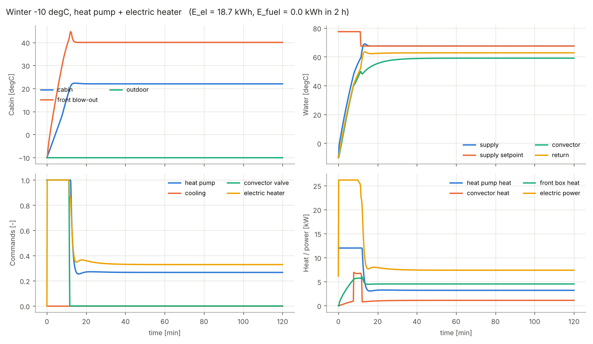
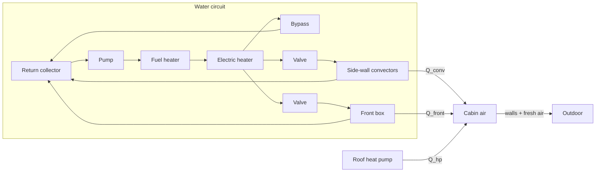
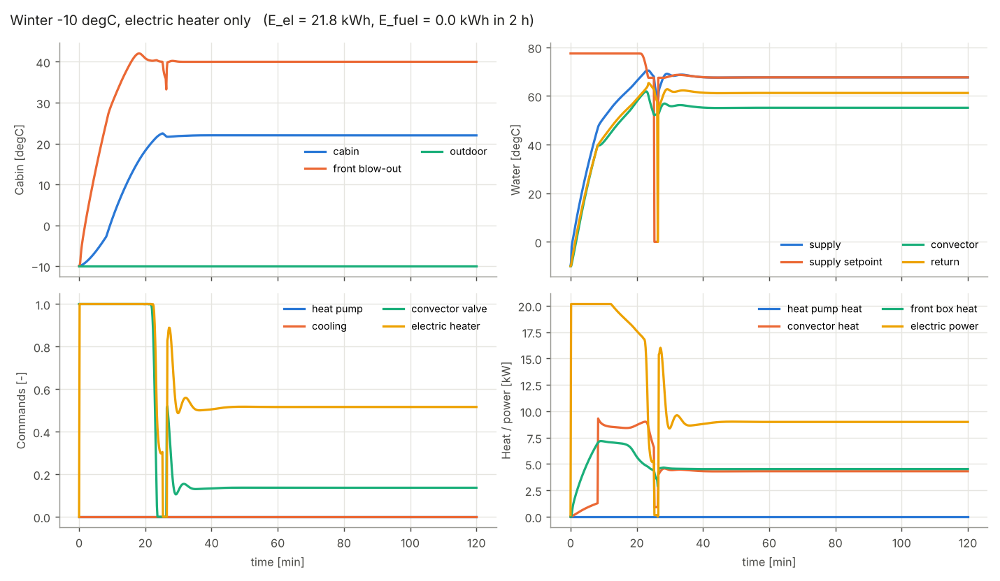
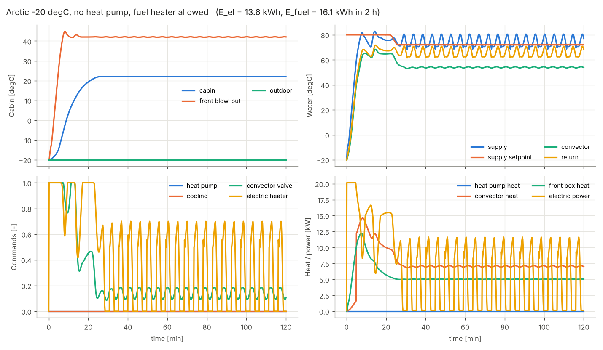
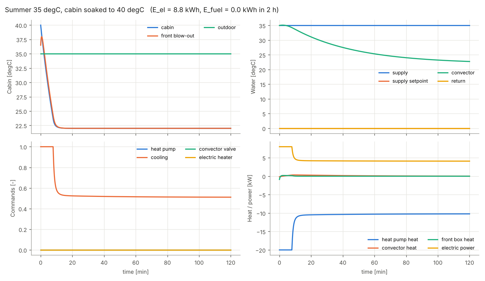
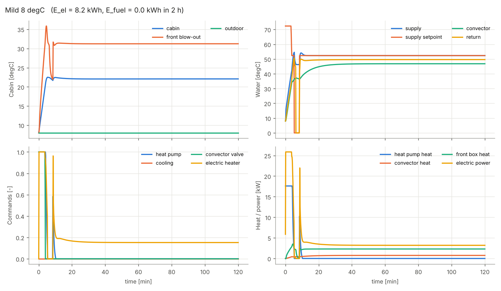

# bus-hvac-simulink

A closed-loop Simulink model of the heating and air-conditioning system of an electric coach:
cabin, hot-water circuit, roof heat pump, electric and fuel-fired water heaters, and the
controller that runs them.

The model is **built by a script** from basic Simulink blocks only. No Simscape and no other
toolbox is needed, so it opens in any MATLAB / Simulink installation, including the Student Suite.

> All numbers are generic, textbook-level assumptions for a 12 m coach. The model does not
> describe any specific vehicle or product and has not been validated against measurements.



## Quick start

```matlab
build_bus_hvac      % creates bus_hvac.slx
run_scenarios       % runs 5 scenarios, plots them, saves docs/*.png
design_controller   % optional, needs Control System Toolbox
```

| File | Purpose |
|---|---|
| `bus_hvac_params.m` | every parameter, with unit and meaning |
| `build_bus_hvac.m` | builds the whole model |
| `run_scenarios.m` | winter / arctic / summer / mild runs and plots |
| `design_controller.m` | checks the cabin PI gains with `pidtune` |

Target: MATLAB R2020b or newer.

## System



## Physics

Every thermal element is a lumped, well-mixed node.

**Cabin**

```
C_cab * dT_cab/dt = Q_conv + Q_front + Q_hp + Q_passengers + Q_solar
                    - (UA_cab + m_fresh*cp_air) * (T_cab - T_out)
```

**Water node** (collector, heaters, convectors, front box pipes)

```
M * c_w * dT/dt = mdot * c_w * (T_in - T) + Q
```

**Heat exchangers** are not heat sources. Their heat follows the temperature difference:

```
Q_conv  = UA_conv(fan stage) * (T_conv - T_cab)
T_blow  = T_cab + eps * (T_fhx - T_cab)
Q_front = m_air * cp_air * (T_blow - T_cab)
```

**Hydraulics.** Each branch obeys `dp = K * mdot^2`. With the conductance `G = 1/sqrt(K)`,
parallel branches share the flow in proportion to `G`, and the pump curve
`dp = dp0 - b*mdot^2` gives the total flow:

```
mdot_tot = sqrt( dp0 / (b + K_src + 1/G_tot^2) ),   mdot_i = mdot_tot * G_i / G_tot
```

A valve at opening `h` has `K = K_valve / h^2`.

## Control

| Subsystem | What it does |
|---|---|
| `Supervisor` | heating / ventilation / cooling from `e = T_set - T_cab` with hysteresis, outdoor locks and a minimum dwell time |
| `Cabin_Control` | one PI, split range: `u = 0..1` heat pump, `1..2` convectors, `-1..0` cooling. The efficient source is used first |
| `Convector_Control` | cascade: demand -> water temperature setpoint -> valve PI; fan stages |
| `Front_Control` | valve PI on the blow-out temperature, setpoint from outdoor temperature |
| `Supply_Control` | supply setpoint = highest request + weather-dependent margin; electric heater PI with enable hysteresis and pump pre-run; pump after-run; fuel heater thermostat |

All PI controllers have clamping anti-windup and are built from basic blocks, so the logic is visible.

## Model structure

Subsystems exchange signals only through global `Goto` / `From` tags, so no line crosses
another one. The most useful tags:

| Tag | Meaning | Tag | Meaning |
|---|---|---|---|
| `T_cab` | cabin temperature | `T_supply` | water after the electric heater |
| `e` | `T_set - T_cab` | `T_conv` | convector water |
| `heat`, `cool` | active mode | `T_ret` | mixed return water |
| `u_cab` | cabin PI output | `m_tot`, `m_conv`, `m_front`, `m_byp` | flows |
| `hp_cmd`, `cool_cmd` | heat pump commands | `Q_hp`, `Q_conv`, `Q_front`, `Q_loss` | heat flows |
| `valve_conv`, `valve_front` | valve openings | `P_heater`, `P_fuel`, `P_hp`, `P_el` | powers |
| `heater_cmd`, `pump_cmd`, `fuel_cmd` | water side commands | `E_el_kWh`, `E_fuel_kWh` | energy |

Every tag in the `Logging` subsystem is stored once per second as `out.log_<tag>`.

## Reference results

2 h runs, setpoint 22 degC, 20 passengers (summer: 40 passengers, 3 kW solar).

| Scenario | T_cab 20 min | T_cab 40 min | T_cab 2 h | E_el [kWh] | E_fuel [kWh] |
|---|---|---|---|---|---|
| Winter -10 degC, heat pump + electric heater | 22.0 | 22.0 | 22.0 | 18.7 | 0.0 |
| Winter -10 degC, electric heater only | 18.3 | 22.0 | 22.0 | 21.8 | 0.0 |
| Arctic -20 degC, no heat pump, fuel heater allowed | 19.3 | 22.0 | 22.0 | 13.6 | 16.1 |
| Summer 35 degC, cabin soaked to 40 degC | 22.0 | 22.0 | 22.0 | 8.8 | 0.0 |
| Mild 8 degC | 22.1 | 22.1 | 22.1 | 8.2 | 0.0 |

These numbers and the figures in `docs/` come from an independent Python implementation of
the same block diagram (fixed step 0.5 s). `run_scenarios` overwrites the figures with the
Simulink results; small differences from the solver are expected.

| | |
|---|---|
|  |  |
|  |  |

## Limits

- One air node for the cabin: no stratification, no front / rear difference.
- No humidity, so no latent cooling load and no fogging.
- Heat pump as capacity and COP tables; no refrigerant cycle.
- No heat loss from pipes, no pump heat, incompressible quasi-static hydraulics.
- Parameters are assumptions. Fit them to measurements before drawing conclusions.

## Türkçe özet

Elektrikli bir otobüsün ısıtma-soğutma sisteminin kapalı çevrim Simulink modeli: kabin, sıcak su
devresi, tavan ısı pompası, elektrikli ve yakıtlı su ısıtıcıları ve bunları yöneten kontrol.
Model yalnızca temel Simulink bloklarından oluşur ve `build_bus_hvac` komutuyla sıfırdan kurulur.
Bütün parametreler `bus_hvac_params.m` dosyasındadır ve genel varsayımlardır; belirli bir aracı
temsil etmez.

## License

MIT, see `LICENSE`.
